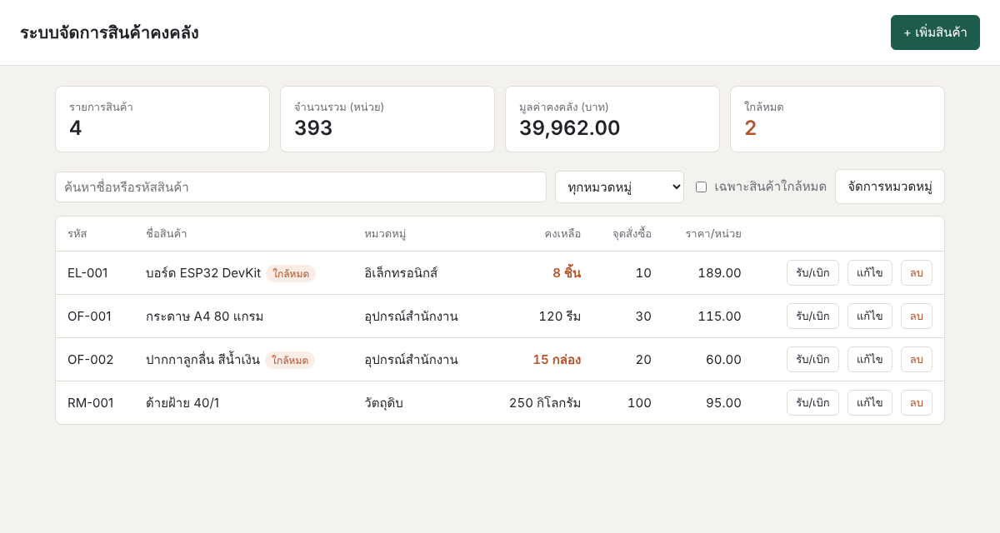

# ระบบจัดการสินค้าคงคลัง (Inventory Management)

เว็บแอปพลิเคชันขนาดเล็กสำหรับจัดการสินค้าคงคลัง ประกอบด้วยฝั่งเซิร์ฟเวอร์ (Node.js + Express) ที่เชื่อมต่อกับฐานข้อมูล SQLite และฝั่งไคลเอนต์ (HTML/CSS/JavaScript) ที่เรียกใช้งานผ่าน REST API



## แอปทำอะไรได้บ้าง

- เพิ่ม แก้ไข ลบ และดูรายการสินค้า (รหัสสินค้า ชื่อ หมวดหมู่ หน่วยนับ ราคา จุดสั่งซื้อ)
- ค้นหาสินค้าจากชื่อหรือรหัส และกรองตามหมวดหมู่หรือเฉพาะสินค้าที่ใกล้หมด
- บันทึกการรับเข้า (IN) และเบิกออก (OUT) พร้อมเก็บประวัติการเคลื่อนไหวของสต็อก ระบบจะไม่ยอมให้เบิกเกินยอดคงเหลือ
- แจ้งเตือนสินค้าที่ยอดคงเหลือต่ำกว่าหรือเท่ากับจุดสั่งซื้อ (min stock)
- สรุปภาพรวมคลัง ได้แก่ จำนวนรายการ จำนวนหน่วยรวม มูลค่าคงคลัง และจำนวนสินค้าใกล้หมด
- จัดการหมวดหมู่สินค้า

## เทคโนโลยีที่ใช้

| ส่วน | เทคโนโลยี |
|---|---|
| Backend | Node.js, Express |
| Database | SQLite (ผ่านแพ็กเกจ `better-sqlite3`) |
| Frontend | HTML, CSS, JavaScript (Fetch API) |
| Dev tool | nodemon |

## โครงสร้างโปรเจกต์

```
inventory-app/
├── server/                 # ฝั่งเซิร์ฟเวอร์
│   ├── index.js            # จุดเริ่มต้นของเซิร์ฟเวอร์ ตั้งค่า Express และ route หลัก
│   ├── db.js               # เชื่อมต่อฐานข้อมูล สร้างตาราง และใส่ข้อมูลตัวอย่าง
│   └── routes/
│       ├── products.js     # endpoint ของสินค้าและการรับเข้า/เบิกออก
│       └── categories.js   # endpoint ของหมวดหมู่
├── public/                 # ฝั่งไคลเอนต์
│   ├── index.html
│   ├── style.css
│   └── app.js
├── docs/images/            # ภาพประกอบ README และภาพหลักฐานการดีบัก
├── .vscode/launch.json     # ค่าตั้งสำหรับดีบักเซิร์ฟเวอร์ใน VS Code
├── package.json
└── README.md
```

## โครงสร้างฐานข้อมูล

ไฟล์ฐานข้อมูล `server/inventory.db` จะถูกสร้างอัตโนมัติเมื่อรันเซิร์ฟเวอร์ครั้งแรก พร้อมข้อมูลตัวอย่าง 4 รายการ

| ตาราง | คอลัมน์หลัก |
|---|---|
| `categories` | `id`, `name` |
| `products` | `id`, `sku`, `name`, `category_id`, `quantity`, `unit`, `price`, `min_stock`, `created_at`, `updated_at` |
| `stock_movements` | `id`, `product_id`, `type` (IN/OUT), `quantity`, `note`, `created_at` |

## วิธีติดตั้ง

ต้องติดตั้ง [Node.js](https://nodejs.org/) เวอร์ชัน 18 ขึ้นไปก่อน จากนั้นรันคำสั่ง

```bash
git clone <ลิงก์ repository นี้>
cd inventory-app
npm install
```

## วิธีรัน

```bash
npm run dev     # โหมดพัฒนา (nodemon รีสตาร์ตเซิร์ฟเวอร์อัตโนมัติเมื่อแก้โค้ด)
# หรือ
npm start       # รันแบบปกติ
```

เปิดเบราว์เซอร์ไปที่ http://localhost:3000

> หากต้องการเริ่มฐานข้อมูลใหม่ ให้ลบไฟล์ `server/inventory.db` แล้วรันเซิร์ฟเวอร์อีกครั้ง

## รายการ Endpoint

ทุก endpoint รับและส่งข้อมูลเป็น JSON

### สินค้า (Products)

| Method | Endpoint | คำอธิบาย |
|---|---|---|
| GET | `/api/products` | ดึงรายการสินค้าทั้งหมด รองรับ query `search`, `category`, `lowStock=true` |
| GET | `/api/products/:id` | ดึงข้อมูลสินค้ารายการเดียว |
| POST | `/api/products` | เพิ่มสินค้าใหม่ |
| PUT | `/api/products/:id` | แก้ไขข้อมูลสินค้า |
| DELETE | `/api/products/:id` | ลบสินค้า |
| POST | `/api/products/:id/stock` | รับเข้าหรือเบิกออกสินค้า |
| GET | `/api/products/:id/movements` | ดูประวัติการรับเข้า/เบิกออกของสินค้า |

### หมวดหมู่ (Categories)

| Method | Endpoint | คำอธิบาย |
|---|---|---|
| GET | `/api/categories` | ดึงหมวดหมู่ทั้งหมด พร้อมจำนวนสินค้าในแต่ละหมวด |
| POST | `/api/categories` | เพิ่มหมวดหมู่ |
| DELETE | `/api/categories/:id` | ลบหมวดหมู่ (สินค้าในหมวดจะเปลี่ยนเป็น "ไม่ระบุหมวด") |

### อื่น ๆ

| Method | Endpoint | คำอธิบาย |
|---|---|---|
| GET | `/api/summary` | สรุปภาพรวมคลังสินค้า |

### ตัวอย่าง Request Body

**POST `/api/products`**
```json
{
  "sku": "OF-003",
  "name": "แฟ้มเอกสาร A4",
  "category_id": 1,
  "quantity": 50,
  "unit": "เล่ม",
  "price": 25,
  "min_stock": 10
}
```

**POST `/api/products/:id/stock`**
```json
{ "type": "OUT", "quantity": 5, "note": "เบิกให้ฝ่ายบัญชี" }
```

### รหัสสถานะที่ใช้

| รหัส | ความหมาย |
|---|---|
| 200 / 201 | สำเร็จ / สร้างข้อมูลสำเร็จ |
| 204 | ลบสำเร็จ (ไม่มีข้อมูลตอบกลับ) |
| 400 | ข้อมูลไม่ถูกต้อง เช่น จำนวนติดลบ หรือเบิกเกินยอดคงเหลือ |
| 404 | ไม่พบข้อมูล |
| 409 | ข้อมูลซ้ำ เช่น รหัสสินค้าซ้ำ |

## หลักฐานการดีบัก

### 1. ดีบักฝั่งเซิร์ฟเวอร์ (VS Code Debugger)

ตั้ง breakpoint ใน `server/routes/products.js` ที่ endpoint `POST /api/products/:id/stock` แล้วรันด้วย configuration **Debug Server** จากนั้นกดรับเข้า/เบิกออกสินค้าจากหน้าเว็บ เพื่อดูค่าตัวแปร `product`, `qty` และ `newQty`


### 2. ดีบักฝั่งไคลเอนต์ (Browser DevTools)

เปิด DevTools (F12) ตั้ง breakpoint ใน `public/app.js` ที่ฟังก์ชัน `loadProducts` และดู request/response ของ `/api/products` ในแท็บ Network


